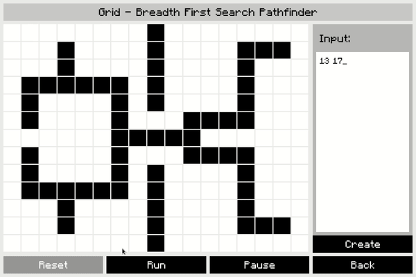
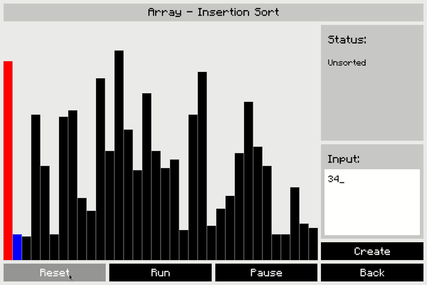
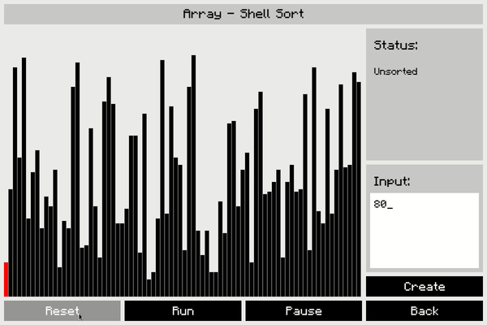
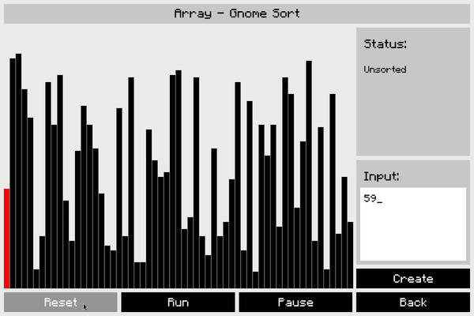
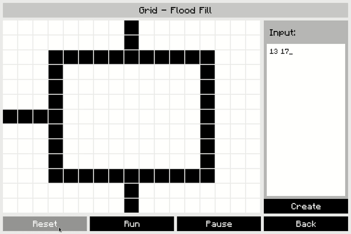
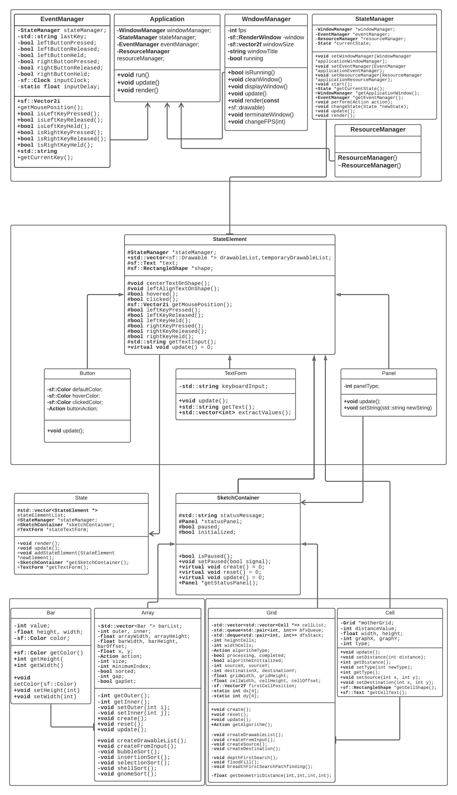

# AlgoVis

An interactive desktop app, written in C++, that animates sorting and pathfinding algorithms step by step so you can see how they work.



## Overview

You build an array or a grid, choose an algorithm, and watch it run. The speed is adjustable and you can pause at any step. I built it to practise C++ application design: a menu-driven UI, a real-time render loop, and algorithms that run one step per frame so they can be animated.

**Tech:** C++, SFML, CMake

## Features

- **8 algorithms**
  - Sorting: Bubble, Selection, Insertion, Shell, Gnome
  - Grid: Flood Fill, BFS shortest path, DFS
- **Custom input:** choose the array size and grid dimensions.
- **Playback controls:** adjust the speed, pause, and resume.
- **Menu-driven interface:** move between sketches and algorithms without restarting.

## Demos

| Insertion Sort | Shell Sort |
|---|---|
|  |  |

| Gnome Sort | Flood Fill |
|---|---|
|  |  |

## Design

The app is split into a few focused parts:

- **Managers** handle the window, input events, shared resources such as fonts, and the stack of screens.
- **States** are the individual screens: the main menu, sketch setup, algorithm selection, and help.
- **Sketches** are the data being visualized (an array or a grid). Each one runs its algorithm one step per frame and draws itself.



## Build and run

You need a C++ compiler, CMake, and SFML 2.5+.

```bash
mkdir build bin && cd build
cmake ..
make
cd ../bin && ./AlgoVis
```

See [BUILD.md](BUILD.md) for detailed setup steps.

## Next steps

- Graph algorithms: Dijkstra, A*
- Tree data structures
- Smoother rendering for large inputs
